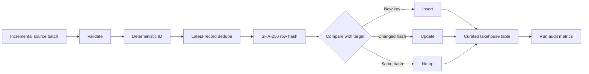

# Reliable Lakehouse Pipeline

[](https://github.com/Jayanth2429/reliable-lakehouse-pipeline/actions/workflows/ci.yml)

A production-style data engineering project demonstrating **incremental ingestion, deterministic business keys, SHA-256 change detection, idempotent MERGE semantics, within-batch deduplication, auditing, and restart-safe processing**.

The dataset is fully synthetic. The project is designed to demonstrate patterns commonly used in Databricks/Delta Lake and other lakehouse architectures without exposing proprietary code or real healthcare data.

## Why this project exists

A pipeline that works once is easy. A production pipeline must also behave correctly when:

- the same source batch is replayed,
- an upstream system sends duplicate versions of the same record,
- a previously processed record changes,
- a job fails and is restarted,
- downstream consumers need trustworthy audit history.

This repository focuses on those reliability concerns.

## Architecture



## Reliability patterns demonstrated

| Pattern | What it solves |
| --- | --- |
| Deterministic business key | Identifies the same logical record across reruns |
| Stable content hash | Detects real business changes without rewriting identical rows |
| Within-batch deduplication | Resolves multiple source versions before MERGE |
| Idempotent merge | Makes replaying the same batch safe |
| Preserve first-ingested timestamp | Separates original arrival time from later updates |
| Run-level audit metrics | Makes inserts, updates, no-ops, and duplicates observable |
| Optional Delta implementation | Maps the design directly to a Databricks-style lakehouse |

## Repository structure

```text
reliable-lakehouse-pipeline/
├── .github/workflows/ci.yml
├── docs/
│   ├── architecture.md
│   └── design-decisions.md
├── sample_data/
│   ├── batch_001.jsonl
│   └── batch_002.jsonl
├── src/lakehouse_pipeline/
│   ├── io.py
│   ├── keys.py
│   ├── local_demo.py
│   ├── merge.py
│   └── spark_delta_pipeline.py
├── tests/
│   ├── test_keys.py
│   └── test_merge.py
├── LICENSE
├── pyproject.toml
└── README.md
```

## Quick start

```bash
python3 -m venv .venv
source .venv/bin/activate
python -m pip install -e ".[dev]"
python -m pytest
```

Run the local two-batch demonstration:

```bash
python -m lakehouse_pipeline.local_demo
```

Expected behavior:

- Batch 1 inserts three synthetic records.
- Batch 2 updates one record, leaves one unchanged, inserts one new record, and resolves one duplicate source version.
- Replaying an already processed batch produces no business-content rewrite for unchanged rows.

The demo writes curated records and run metrics under `demo_output/`, which is intentionally ignored by Git.

## Optional PySpark + Delta Lake path

Install the Spark extra:

```bash
python -m pip install -e ".[spark]"
```

Then run the Delta implementation in a compatible local Spark environment or Databricks workspace:

```bash
python -m lakehouse_pipeline.spark_delta_pipeline \
  --input sample_data/batch_001.jsonl \
  --target /tmp/lakehouse/curated \
  --audit /tmp/lakehouse/audit \
  --run-id demo-001
```

The Spark module implements the same design using built-in Spark hashing, window-based deduplication, and Delta `MERGE`.

## Example merge behavior

| Scenario | Result |
| --- | --- |
| Brand-new deterministic key | Insert |
| Existing key + changed row hash | Update |
| Existing key + identical row hash | No-op |
| Duplicate versions in the same batch | Keep latest `source_updated_at` |
| Replayed unchanged batch | Safe, idempotent no-op |

## Testing

The unit tests verify:

- deterministic-key normalization,
- stable content hashing,
- first-time inserts,
- idempotent reruns,
- changed-record updates,
- within-batch latest-version selection.

GitHub Actions executes the test suite on every push and pull request to `main`.

## Design documentation

- [Architecture](docs/architecture.md)
- [Design decisions](docs/design-decisions.md)

## Privacy and data safety

All records in this repository are synthetic. No patient data, employer source code, internal schemas, proprietary business rules, production credentials, or confidential architecture are included.

## Skills demonstrated

`Python` · `PySpark` · `Delta Lake` · `Databricks patterns` · `SQL concepts` · `SHA-256` · `Idempotency` · `Incremental ingestion` · `Data quality` · `MERGE` · `CI/CD` · `Production reliability`
