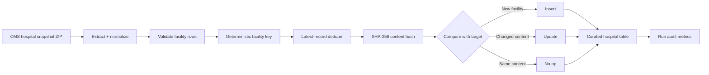

# Reliable Lakehouse Pipeline

[](https://github.com/Jayanth2429/reliable-lakehouse-pipeline/actions/workflows/ci.yml)

A production-style lakehouse project using **real public CMS hospital snapshot data** to demonstrate **incremental ingestion, deterministic business keys, SHA-256 change detection, idempotent MERGE semantics, snapshot deduplication, auditing, and restart-safe processing**.

## Why this project exists

A pipeline that works once is easy. A production pipeline must also behave correctly when:

- a source snapshot is replayed,
- the same facility appears more than once in an incoming batch,
- a hospital attribute changes between public releases,
- a job fails and is restarted,
- downstream consumers need trustworthy audit history.

This repository demonstrates those concerns using successive releases of CMS Hospital General Information rather than synthetic application records.

## Public data source

The source is the **CMS Provider Data Catalog** Hospital General Information dataset. CMS also publishes historical hospital snapshots, making the data useful for a real incremental/change-detection demonstration.

See [`DATA_SOURCES.md`](DATA_SOURCES.md) for official links and source details.

## Architecture



## Reliability patterns demonstrated

| Pattern | What it solves |
| --- | --- |
| Deterministic facility key | Identifies the same hospital across CMS snapshots |
| Stable content hash | Detects real attribute changes without rewriting identical rows |
| Within-batch deduplication | Keeps the latest source version for a facility |
| Idempotent MERGE | Makes replaying the same public snapshot safe |
| Preserve first-ingested timestamp | Separates original arrival from later updates |
| Run-level audit metrics | Makes inserts, updates, no-ops, and duplicates observable |
| Optional Delta implementation | Maps the design directly to a Databricks-style lakehouse |

## Repository structure

```text
reliable-lakehouse-pipeline/
├── .github/workflows/ci.yml
├── docs/
│   ├── architecture.md
│   └── design-decisions.md
├── scripts/
│   └── extract_cms_snapshot.py
├── src/lakehouse_pipeline/
│   ├── io.py
│   ├── keys.py
│   ├── local_demo.py
│   ├── merge.py
│   └── spark_delta_pipeline.py
├── tests/
│   ├── test_keys.py
│   └── test_merge.py
├── DATA_SOURCES.md
├── LICENSE
├── pyproject.toml
└── README.md
```

## Quick start

```bash
python3 -m venv .venv
source .venv/bin/activate
python -m pip install -e ".[dev]"
python -m pytest
```

### 1. Download two public CMS hospital snapshots

Open the official archive page:

https://data.cms.gov/provider-data/archived-data/hospitals

Download two chronological **Hospitals Snapshot** ZIPs, for example the snapshots listed for `2026-02-25` and `2026-05-13`.

Store them under `data/raw/` (ignored by Git).

### 2. Normalize each snapshot

```bash
python scripts/extract_cms_snapshot.py \
  --input data/raw/hospitals-2026-02-25.zip \
  --snapshot-date 2026-02-25 \
  --output data/normalized/2026-02-25.jsonl

python scripts/extract_cms_snapshot.py \
  --input data/raw/hospitals-2026-05-13.zip \
  --snapshot-date 2026-05-13 \
  --output data/normalized/2026-05-13.jsonl
```

The archive filenames on your machine may differ; pass the actual downloaded paths.

### 3. Run the incremental comparison

```bash
python -m lakehouse_pipeline.local_demo \
  data/normalized/2026-02-25.jsonl \
  data/normalized/2026-05-13.jsonl
```

The output reports how many facility rows were inserted, updated, unchanged, or deduplicated and writes a curated state plus audit log under `demo_output/`.

## Optional PySpark + Delta Lake path

```bash
python -m pip install -e ".[spark]"
```

Then run each normalized snapshot into the same Delta target in chronological order:

```bash
python -m lakehouse_pipeline.spark_delta_pipeline \
  --input data/normalized/2026-02-25.jsonl \
  --target /tmp/lakehouse/curated_hospitals \
  --audit /tmp/lakehouse/audit \
  --run-id cms-2026-02-25
```

Repeat for the later snapshot using the same target and audit paths.

## Testing strategy

The actual demonstration uses public CMS source data. Unit tests intentionally use tiny deterministic fixtures so edge cases such as changed content, metadata-only changes, and duplicate source versions remain predictable in CI.

## Skills demonstrated

`Python` · `PySpark` · `Delta Lake` · `Databricks patterns` · `CMS public data` · `SHA-256` · `Idempotency` · `Incremental ingestion` · `Data quality` · `MERGE` · `CI/CD` · `Production reliability`
