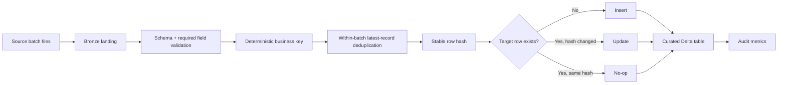

# Architecture

## Layers

- **Bronze:** immutable landed source files with ingestion metadata.
- **Silver / curated:** one current row per deterministic business key.
- **Audit:** run-level counts for source rows, inserts, updates, unchanged rows, duplicates, and processing timestamps.

The local reference implementation demonstrates the merge semantics without requiring Spark. The optional PySpark + Delta module maps the same design to a lakehouse runtime.
